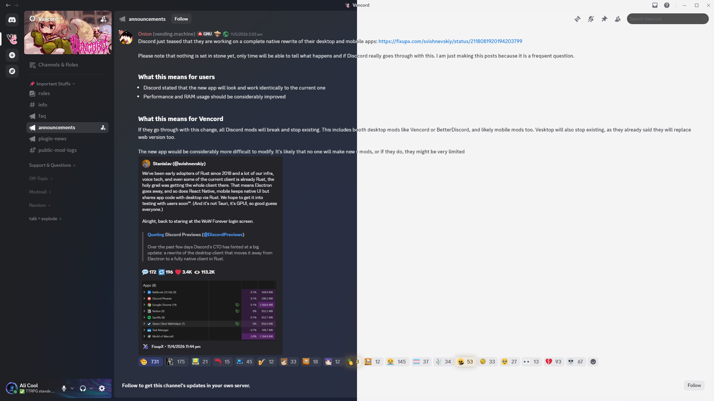

# Discord Semi-Fluent
Theme for Vencord to mimic Fluent Design Language.



## To Enable Transparency
### Requirements
[BetterDiscord](https://betterdiscord.app/) with [MicaForEveryone](https://github.com/MicaForEveryone/MicaForEveryone) or [Vencord](https://vencord.dev/).

### BetterDiscord
1. Add `discord.exe` process to MicaForEveryone and set backdrop type to "Mica" (or any that you'd like).
2. Enable transparency in BetterDiscord settings.

### Vencord
1. Select "Mica" background material (or any that you'd like) at the very bottom of Vencord settings.
2. Relaunch Discord.

## To Apply Theme
### Local File
1. Download [`fluent-discord.css`](https://github.com/AliCool412/Discord-Semi-Fluent/blob/main/fluent-discord.css) and copy/move it to your BetterDiscord/Vencord theme folder.
2. Enable it from your respective theme settings.

### QuickCSS
1. Go to  [`fluent-discord.css`](https://github.com/AliCool412/Discord-Semi-Fluent/blob/main/fluent-discord.css).
2. Copy raw file.
3. Paste it in your QuickCSS editor.

### Online Themes
Paste the following into the theme URLs section :

```
https://raw.githubusercontent.com/AliCool412/Discord-Semi-Fluent/main/semi-fluent-discord.css
```

## Light/Dark Mode Notice
The theme doesn't manually change text colors with light and dark modes, so for that you're gonna have to manually set the dark and light theme in appearance settings, toggling between light and dark mode might also break transparency so make sure to relaunch your discord after toggling.
